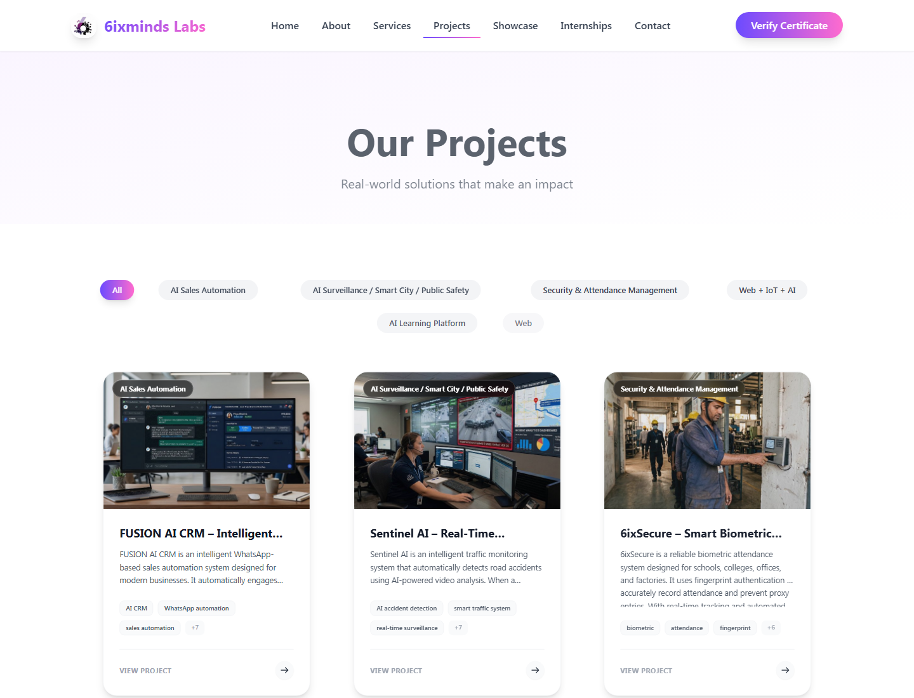
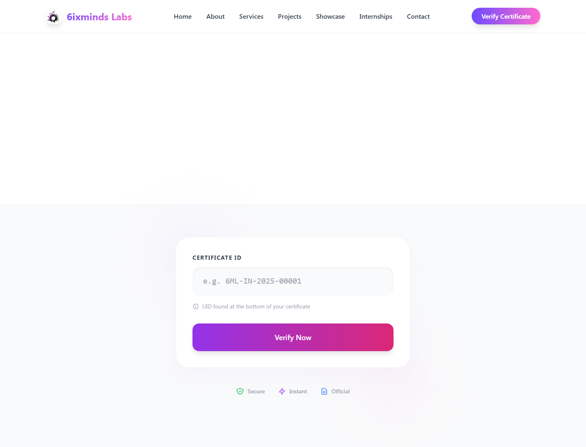
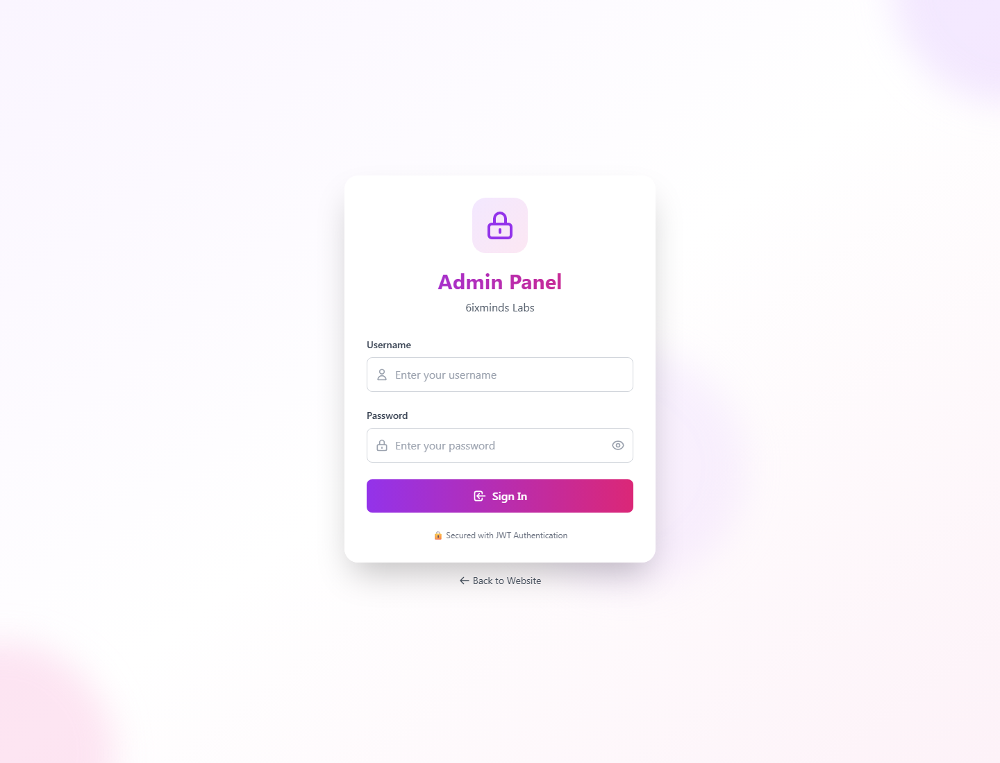
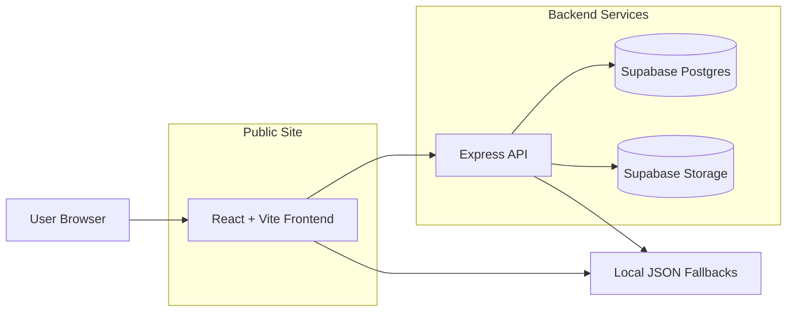

# 6ixminds Labs

Official full-stack website and admin panel for **6ixminds Labs**, a technology lab focused on web development, IoT, embedded systems, AI solutions, internships, certificates, and project showcases.

Live site: https://www.6ixmindslabs.in/

## Screenshots

### Home


### Projects



### Certificate Verification



### Admin Login



## Features

- Public website with Home, About, Services, Projects, Showcase, Internships, Contact, and Certificate Verification pages.
- Admin panel for managing internships, projects, certificates, team members, messages, and showcase items.
- Certificate verification by certificate ID.
- Supabase-backed API for team, projects, internships, certificates, messages, and showcase content.
- Supabase Storage support for certificate, profile, and showcase media uploads.
- Contact form with backend persistence and optional EmailJS delivery.
- Local JSON fallbacks for public pages so the app can still run during development without a configured database.
- Responsive React UI with animations, SEO metadata, and Vite production builds.

## Tech Stack

| Area | Technology |
| --- | --- |
| Frontend | React 19, Vite, React Router |
| Styling | Tailwind CSS, Framer Motion |
| Icons and UI | Lucide React, custom reusable components |
| Backend | Node.js, Express |
| Database | Supabase Postgres |
| Storage | Supabase Storage |
| Auth | Admin session flow for protected dashboard routes |
| Forms | Backend API, optional EmailJS |
| Deployment | Vercel-compatible frontend and backend configs |

## Architecture Overview



The frontend reads `VITE_API_URL` for API calls. In development, it defaults to `http://localhost:5000`. The backend uses `SUPABASE_URL` and `SUPABASE_KEY` to talk to Supabase. If Supabase is not configured locally, public routes can fall back to bundled JSON data.

## Project Structure

```text
6ixmindslabs/
|-- backend/
|   |-- api/
|   |   `-- index.js
|   |-- config/
|   |   `-- supabaseClient.js
|   |-- routes/
|   |-- scripts/
|   |-- server.js
|   |-- package.json
|   `-- vercel.json
|-- frontend/
|   |-- public/
|   |-- src/
|   |   |-- components/
|   |   |-- contexts/
|   |   |-- data/
|   |   |-- lib/
|   |   |-- pages/
|   |   `-- utils/
|   |-- package.json
|   `-- vercel.json
|-- docs/
|   `-- screenshots/
|-- package.json
`-- README.md
```

## Setup Instructions

### Prerequisites

- Node.js 18 or newer
- npm 9 or newer
- Supabase project for database-backed admin CRUD
- Optional EmailJS account for email delivery from the contact form

### Install Dependencies

Run from the project root:

```bash
npm install
npm run install:all
```

### Configure Environment Variables

Copy the example files:

```bash
copy frontend\.env.example frontend\.env
copy backend\.env.example backend\.env
```

Frontend environment:

```env
VITE_API_URL=http://localhost:5000
VITE_SUPABASE_URL=
VITE_SUPABASE_ANON_KEY=
VITE_EMAILJS_SERVICE_ID=
VITE_EMAILJS_TEMPLATE_ID=
VITE_EMAILJS_PUBLIC_KEY=
```

Backend environment:

```env
PORT=5000
NODE_ENV=development
SUPABASE_URL=
SUPABASE_KEY=
JWT_SECRET=change-this-to-a-long-random-secret
RATE_LIMIT_WINDOW_MS=60000
RATE_LIMIT_MAX_REQUESTS=100
LOGIN_RATE_LIMIT_WINDOW_MS=900000
LOGIN_RATE_LIMIT_MAX_ATTEMPTS=5
```

### Run Locally

Start the frontend and backend together:

```bash
npm run dev
```

Open:

- Frontend: http://localhost:5173
- Backend health: http://localhost:5000/health
- Admin panel: http://localhost:5173/admin/login

### Useful Commands

```bash
npm run dev           # frontend + backend
npm run dev:frontend  # Vite frontend only
npm run dev:backend   # Express backend only
npm run build         # production frontend build
npm run preview       # preview production frontend build
npm start             # start backend
```

Backend-only commands:

```bash
npm run check-db --prefix backend
npm run seed --prefix backend
```

## Supabase Setup

Run the SQL files in `backend/` inside your Supabase SQL editor as needed:

- `SUPABASE_SCHEMA.sql`
- `SUPABASE_SHOWCASE_SCHEMA.sql`
- `SUPABASE_STORAGE_SETUP.sql`
- `SUPABASE_SHOWCASE_STORAGE.sql`
- certificate/message fix scripts if your schema is older

For admin writes and storage uploads, use a Supabase key with the correct permissions. In production, keep service-role keys only on the backend.

## Deployment

Production deployment:

```text
https://www.6ixmindslabs.in/
```

The root domain also resolves to the live site:

```text
https://6ixmindslabs.in/
```

### Frontend Deployment

The frontend is Vercel-ready through `frontend/vercel.json`:

- Framework: Vite
- Build command: `npm run build`
- Output directory: `dist`
- SPA rewrite: all routes to `index.html`

Required frontend variables in production:

```env
VITE_API_URL=https://your-backend-url
VITE_SUPABASE_URL=your_supabase_url
VITE_SUPABASE_ANON_KEY=your_supabase_anon_key
VITE_EMAILJS_SERVICE_ID=optional
VITE_EMAILJS_TEMPLATE_ID=optional
VITE_EMAILJS_PUBLIC_KEY=optional
```

### Backend Deployment

The backend is Vercel-ready through `backend/vercel.json`, which routes requests to `backend/api/index.js`.

Required backend variables in production:

```env
NODE_ENV=production
SUPABASE_URL=your_supabase_url
SUPABASE_KEY=your_backend_supabase_key
JWT_SECRET=your_long_random_secret
```

## Security Notes

- Use a production-ready authentication provider or database-backed auth system before public admin use.
- Never expose Supabase service-role keys in frontend variables.
- Rotate `JWT_SECRET` before public deployment.
- Keep `.env` files out of git.

## Verification Checklist

```bash
npm run build
npm audit --prefix frontend
npm audit --prefix backend
npm run check-db --prefix backend
```

Expected local services:

- `http://localhost:5173` returns the frontend.
- `http://localhost:5000/health` returns a successful backend health response.
